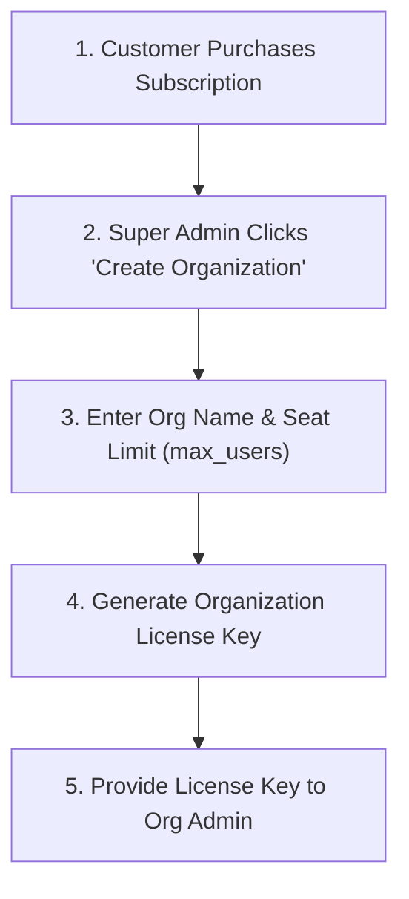

# 👑 MEP Calculator — Super Admin System Operations Manual

> [!IMPORTANT]
> This manual is strictly intended for **Super Admins (Application Provider & System Administrators)**. It details global tenant management, license key generation, seat allocation, database backup restoration, and system audit logging.

---

## 🗂️ Table of Contents
1. [🏢 Global Organization Management](#-1-global-organization-management)
2. [🔑 License Key Generation & Seat Allocation](#-2-license-key-generation--seat-allocation)
3. [💾 Database Backup, Restoration & Emergency Recovery](#-3-database-backup-restoration--emergency-recovery)
4. [🛡️ Global System Audit Logs & Security Control](#-4-global-system-audit-logs--security-control)
5. [📦 Release & Desktop Installer Management](#-5-release--desktop-installer-management)

---

## 🏢 1. Global Organization Management

As a Super Admin, you manage all customer organizations using the **Super Admin Dashboard** (*http://localhost:8081/admin/super*):

### Creating & Editing Organizations:
1. Open **Super Admin Dashboard ➔ Organizations Tab**.
2. Click **"Create Organization"**.
3. Input:
   - **Organization Name**: e.g., *ABC Engineering Consultants LLC*
   - **Subscription Plan**: e.g., *Pro Enterprise*
   - **Max Users Seat Limit (`max_users`)**: e.g., `10` seats
4. Click **Save**. The system assigns a unique Organization UUID.

---

## 🔑 2. License Key Generation & Seat Allocation

### Generating Standalone & Organization License Keys:
1. Go to **Super Admin Dashboard ➔ License Management**.
2. Click **"Generate License Key"**.
3. Select License Parameters:
   - **Bound Organization**: Select target organization.
   - **Duration / Expiration**: e.g. 365 Days.
   - **Max User Capacity**: e.g. 10 users.
4. Click **Generate Key**.
5. Copy the generated key (format: `MEP-XXXX-XXXX-XXXX`) and send it to the customer Organization Admin.

### Revoking & Managing License Keys:
- To revoke a key immediately, click **"Revoke"** next to the license key. The system will log out all bound devices on their next 30-second polling cycle.

---

## 💾 3. Database Backup, Restoration & Emergency Recovery

### Manual Backup Generation:
- Click **"Backup Database Now"** in the Admin Control Panel.
- The server exports a complete timestamped JSON dump (`mep_backup_YYYY-MM-DD.json`) containing all users, projects, teams, licenses, and logs.

### Atomic Database Restore:
1. Click **"Restore Database"**.
2. Select your timestamped backup JSON file.
3. Click **Hydrate & Restore**. The backend will overwrite database tables and clear in-memory caches atomically.

---

## 🛡️ 4. Global System Audit Logs & Security Control

- Navigate to **Super Admin Dashboard ➔ Global Audit Logs**.
- Filter activity logs by:
  - **Action Type**: `REGISTER`, `LOGIN`, `CREATE_ORGANIZATION`, `ADMIN_DELETE_USER`, `SAVE_VERSION`.
  - **Date Range / Organization Name**.
- Super Admins can inspect activity logs across all organizations globally.

---

## 📦 5. Release & Desktop Installer Management

To publish a new desktop build update:
1. Update version in `package.json`, `tauri.conf.json`, `Cargo.toml`, and `update.json` to e.g. `"0.0.4"`.
2. Run `npm run tauri:full` to compile the installer executable (`MEP Calculator_0.0.4_x64-setup.exe`).
3. Deploy the updated `update.json` manifest to your cloud server. Installed desktop apps will display the **Auto-Update Notification Modal** on launch!
