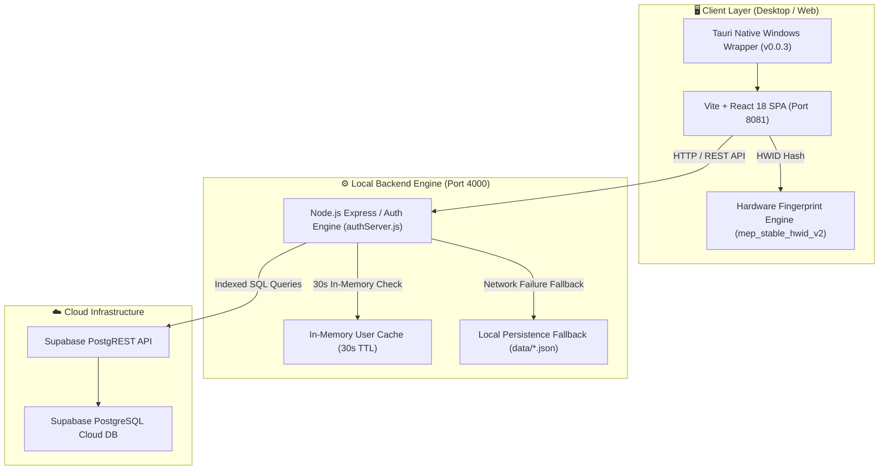
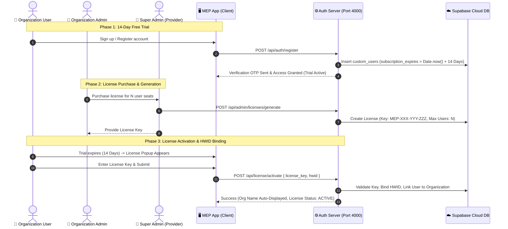
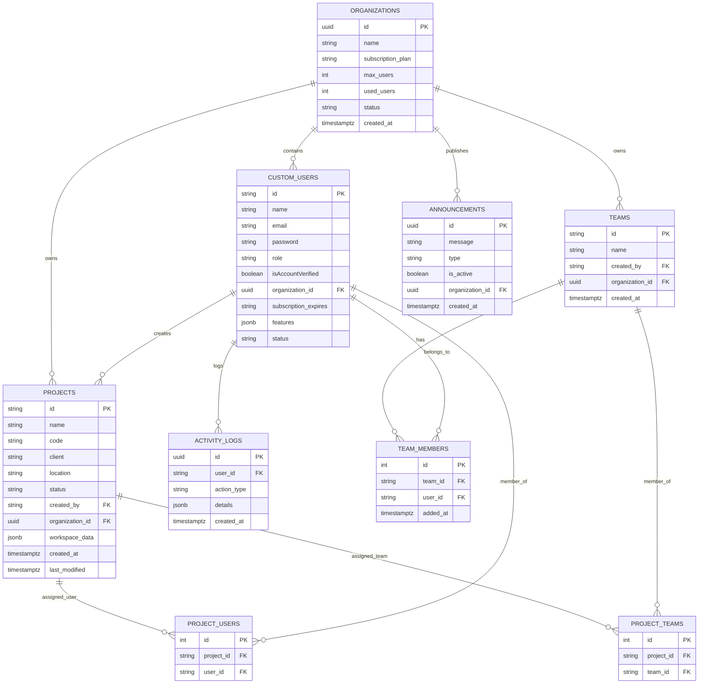
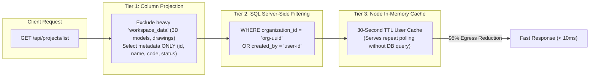

# 🚀 MEP Calculator — System Architecture & Data Flow Guide

> [!NOTE]
> This document provides an end-to-end technical overview of the MEP Calculator enterprise platform, detailing the system topology, license lifecycle, entity-relationship database schema, multi-tenant security model, and performance/egress optimization strategy.

---

## 📐 1. High-Level System Architecture Topology

The application operates as a hybrid Tauri Desktop / Web Client communicating with an optimized local Node.js Authentication & License Engine, backed by Supabase PostgreSQL Cloud Database storage.

---

## 🔑 2. License Lifecycle & Activation Flow

This diagram illustrates the complete 14-day free trial, license key purchase, Super Admin generation, user activation, hardware binding, and organization auto-display.

---

## 🗄️ 3. Complete Database Entity-Relationship Diagram (ERD)

The relational schema ensures strict multi-tenant isolation by anchoring `custom_users`, `teams`, `projects`, and `announcements` to `organizations.id`.

---

## 🔒 4. Multi-Tenant Access Control & Security Matrix

Access control enforces role-based permissions (RBAC) across Super Admins, Organization Admins, Senior Design Engineers, Junior Design Engineers, and Viewers.

| Role | Scope | Organization Management | Project Creation & Edit | User Assignment | Log Audit Access |
| :--- | :--- | :---: | :---: | :---: | :---: |
| 👑 **SUPER_ADMIN** | Global System | Full CRUD across all orgs | Full Access | Full Access | Global System Logs |
| 🏢 **ORG_ADMIN** | Single Organization | Manage Org seats & users | Full Access within Org | Assign Org users/teams | Organization Logs |
| 👷 **Sr. Design Engineer** | Organization Projects | View Org settings | Full Create, Edit & Delete | Assign Team Members | Personal Activity Logs |
| 🔧 **Jr. Design Engineer** | Assigned Projects | None | Create & Edit Assigned | Assigned Teams | Personal Activity Logs |
| 👁️ **Viewer** | Assigned Projects | None | Read-Only | None | Read-Only |

---

## ⚡ 5. Egress Optimization & Bandwidth Management

To prevent high Supabase network egress costs, the system uses a three-tier performance optimization strategy:

