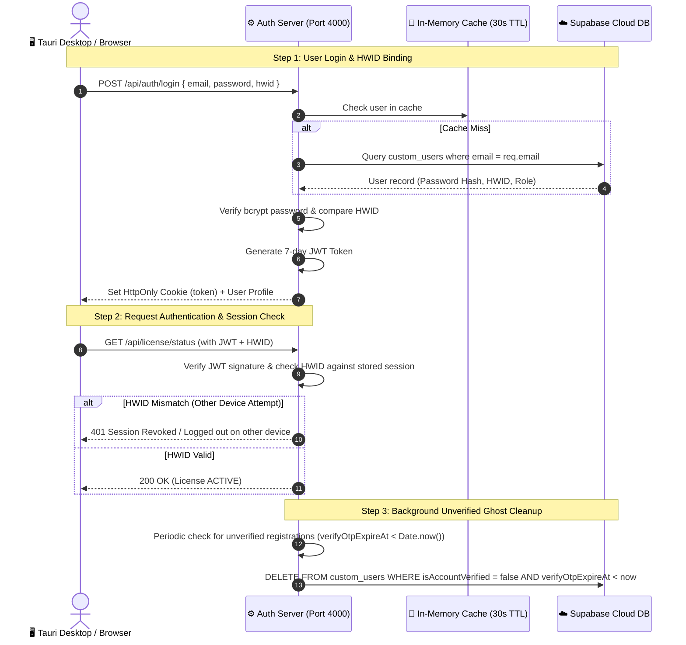
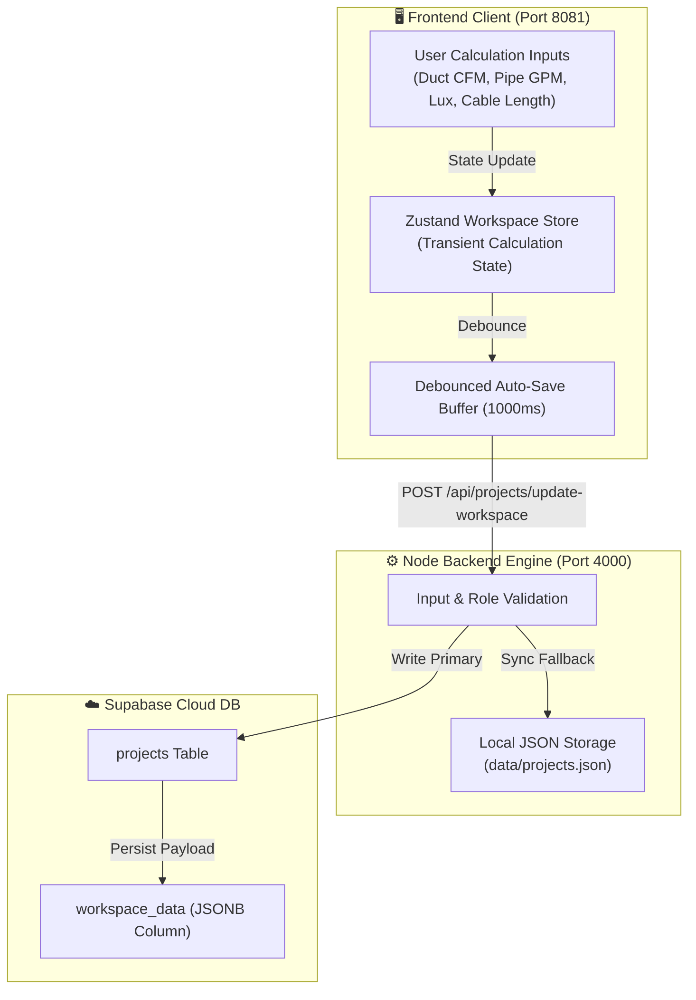
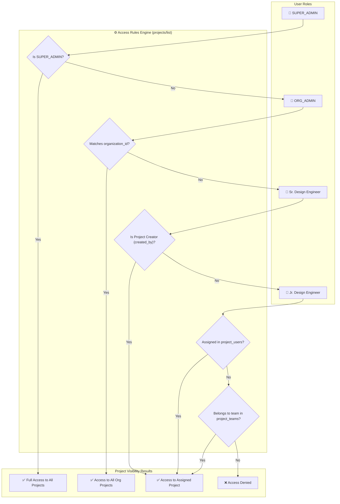
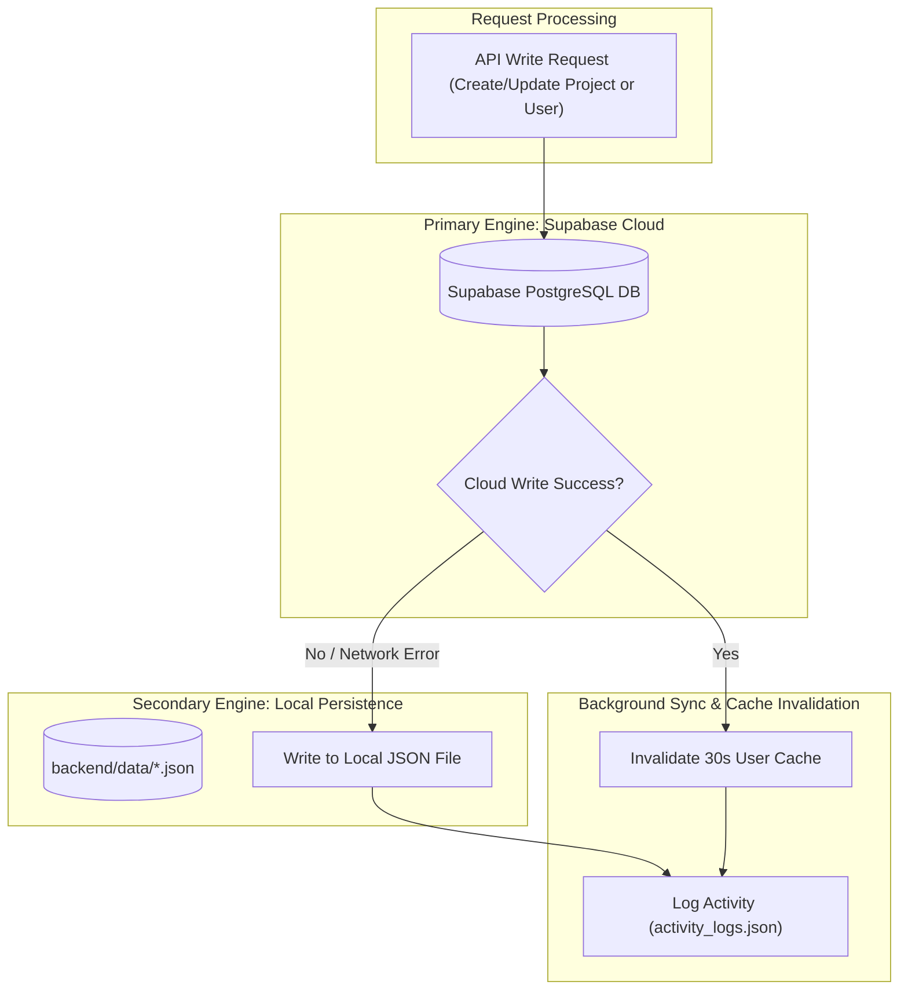

# 🏛️ Advanced MEP Calculator — Deep-Dive Architectural Diagrams

> [!NOTE]
> This guide provides five detailed, component-level architectural diagrams covering authentication security, calculation state flow, access inheritance, the auto-updater pipeline, and dual-storage resilience.

---

## 🔐 1. Authentication, Session & Hardware Security Flow

This diagram illustrates how user authentication, JWT token signing, Hardware Fingerprint (`mep_stable_hwid_v2`) verification, session revocation, and unverified account auto-cleanup operate.



---

## 🧮 2. Project Calculation Data & State Pipeline

This diagram shows how complex MEP engineering calculations (Duct Sizer, CHW Pump Head, Electrical Cable Drop, Plumbing Fixture Units) flow from the React UI into local state, through the backend, and persist to Supabase JSONB.



---

## 👥 3. Team & Project Assignment Access Inheritance

This chart demonstrates how project visibility is dynamically computed based on direct user assignment, team membership, or organization admin privileges.



---

## 🚀 4. Auto-Updater & Build Deployment Pipeline

This diagram shows how the Tauri desktop executable (`MEP Calculator_0.0.3_x64-setup.exe`) is compiled, packaged with NSIS, and checked against `update.json` for seamless desktop releases.

```mermaid
flowchart TD
    subgraph Build Phase ["📦 Build Phase (npm run tauri:full)"]
        ViteBuild["1. Vite Production Build"]
        NitroBuild["2. Nitro Server Bundle (dist-nitro-2)"]
        CSRPatch["3. Tauri CSR Patch (createRoot injection)"]
        CargoBuild["4. Cargo Rust Release Build (v0.0.3)"]
        NSISPackage["5. NSIS Installer Generator"]
        ExecOutput["MEP Calculator_0.0.3_x64-setup.exe (5.66 MB)"]
    end

    subgraph Update Check ["🌐 Client Auto-Update Check"]
        AppStart["App Launch (v0.0.3)"]
        FetchManifest["Fetch public/update.json"]
        CompareVersion{"Is update.json version > CURRENT_VERSION?"}
        ShowModal["Show Update Notification Modal"]
        NoAction["No Modal (App Up-to-Date)"]
    end

    ViteBuild --> NitroBuild
    NitroBuild --> CSRPatch
    CSRPatch --> CargoBuild
    CargoBuild --> NSISPackage
    NSISPackage --> ExecOutput

    AppStart --> FetchManifest
    FetchManifest --> CompareVersion
    CompareVersion -->|Yes (e.g. 0.0.4 > 0.0.3)| ShowModal
    CompareVersion -->|No (0.0.3 == 0.0.3)| NoAction
```

---

## 🛡️ 5. Dual-Storage Resilience & Fallback Topology

This diagram details the high-availability architecture ensuring zero data loss if network connectivity drops or network-share file locks occur.


