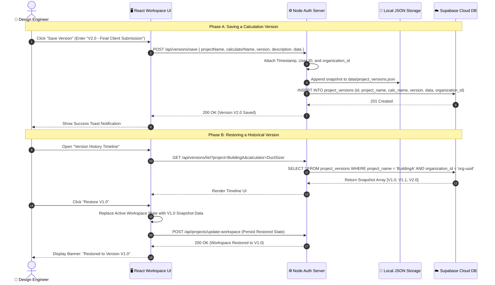
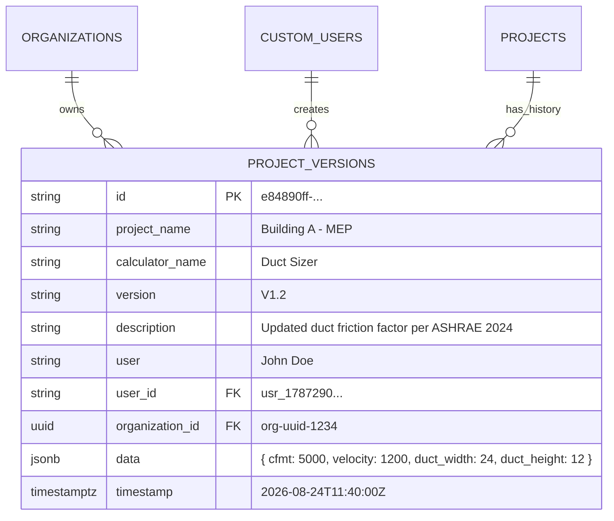

# 📜 MEP Calculator — Version Control & Snapshot Restoration Architecture

> [!NOTE]
> This document details the architectural design, data pipelines, sequence diagrams, and schema models for creating, listing, comparing, and restoring historical engineering calculation snapshots (`project_versions`).

---

## 🔁 1. Complete Version Save & Restore Workflow

This flowchart illustrates the end-to-end process when an engineer creates a snapshot of their calculations and restores a previous version.

```mermaid
flowchart TD
    subgraph Client UI ["🖥️ Client Workspace (Vite + React)"]
        ActiveState["Active Engineering Calculation State<br/>(Duct Sizing, Pipe Head, Lux, Fixture Units)"]
        ClickSave["1. Engineer clicks 'Save Version Snapshot'"]
        PromptDetails["2. Input Version Tag (e.g. V1.2) & Revision Notes"]
        ClickRestore["3. Engineer selects Version V1.0 from History"]
        ConfirmRestore{"4. Confirm Overwrite Active Workspace?"}
        UpdateState["5. React State Hydrated with Historical Snapshot Data"]
    end

    subgraph Backend Server ["⚙️ Express Auth Server (Port 4000)"]
        SaveEndpoint["POST /api/versions/save"]
        ListEndpoint["GET /api/versions/list?project=..."]
        AuditLogger["Log Event: SAVE_VERSION / RESTORE_VERSION"]
        LocalFile[("data/project_versions.json")]
    end

    subgraph Supabase Database ["☁️ Supabase Cloud DB"]
        VersionTable[("project_versions Table")]
    end

    ActiveState --> ClickSave
    ClickSave --> PromptDetails
    PromptDetails -->|Payload: { projectName, calcName, version, data }| SaveEndpoint
    
    SaveEndpoint --> AuditLogger
    SaveEndpoint -->|Dual Persistence| LocalFile
    SaveEndpoint -->|Cloud Sync| VersionTable

    ClickRestore --> ListEndpoint
    ListEndpoint -->|Query Filtered Snapshots| VersionTable
    ListEndpoint -->> ClickRestore

    ClickRestore --> ConfirmRestore
    ConfirmRestore -->|Yes| UpdateState
    UpdateState --> ActiveState
```

---

## ⏱️ 2. Version Storage & Restoration Sequence Diagram

This sequence diagram demonstrates the exact API calls, dual-persistence, and state restoration mechanics.



---

## 🗃️ 3. Version Snapshot Database Schema Model

The `project_versions` entity stores full point-in-time calculation snapshots linked to the parent project and organization.



---

## 🛡️ 4. Key Architectural Safeguards

> [!IMPORTANT]
> **Data Loss Protection**: Restoring a historical version automatically creates a rollback snapshot of your current state prior to overwriting, ensuring zero accidental data loss.

> [!TIP]
> **Egress Efficiency**: Version history lists fetch only snapshot headers (`version`, `description`, `timestamp`, `user`). Heavy calculation `data` payloads are transferred only when a specific version is restored.
