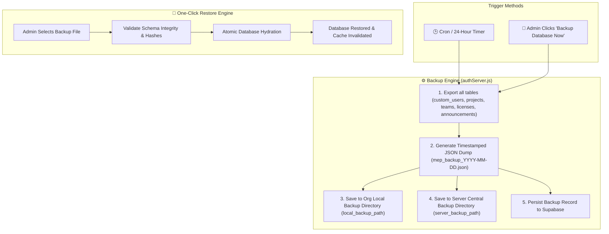
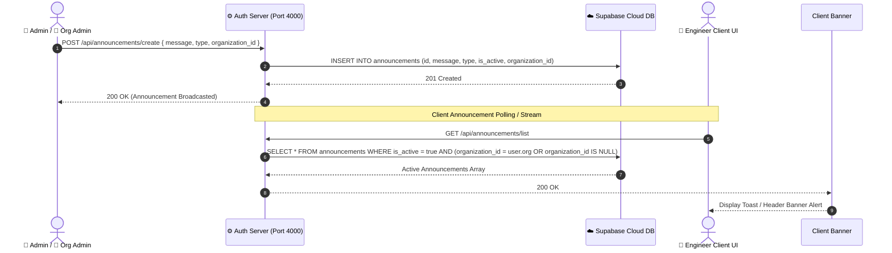
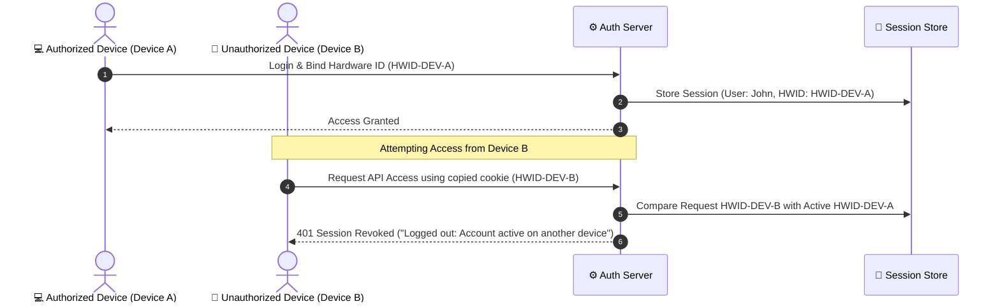

# 🏰 MEP Calculator — Final Master Subsystem Architecture Diagrams

> [!NOTE]
> This final master guide completes the full architectural documentation suite for the MEP Calculator, covering Automated Database Backups, Announcement Broadcasting, Seat License Pool Management, Hardware Device Anti-Abuse, and Network-Share Lock Resilience.

---

## 💾 1. Automated Database Backup & Cloud Recovery Architecture

This diagram illustrates how automatic daily database backups, local directory exports, and one-click cloud database restoration operate.



---

## 📢 2. Global & Organization Announcement Broadcasting Architecture

This diagram shows how Super Admins and Org Admins publish real-time system alerts, maintenance notices, and organization notifications.



---

## 🎫 3. License Seat Pool & Organization Capacity Management

This flowchart illustrates how license seats (`max_users` vs `used_users`) are allocated, tracked, and checked whenever a new user joins an organization.

```mermaid
flowchart TD
    UserJoin["User Enters Organization License Key"]
    FetchOrg["Query organizations Table by license_key"]
    CheckSeats{"Is used_users < max_users?"}
    
    AllowJoin["1. Bind custom_users.organization_id = org.id<br/>2. Increment organizations.used_users = used_users + 1<br/>3. Set user.subscription_expires = license expiration"]
    RejectJoin["❌ Reject Activation: 'Organization seat capacity reached (N/N max users). Contact your Admin to upgrade seats.'"]
    
    UserJoin --> FetchOrg
    FetchOrg --> CheckSeats
    CheckSeats -->|Yes (Seat Available)| AllowJoin
    CheckSeats -->|No (Limit Reached)| RejectJoin
```

---

## 🛡️ 4. Hardware Fingerprint Anti-Abuse & Multi-Device Control

This diagram shows how hardware fingerprints (`mep_stable_hwid_v2`) prevent license key leaks and account sharing across unauthorized devices.



---

## 🔄 5. Network-Share File Lock Retry & Resilience Architecture

This diagram shows the automatic retry mechanism that handles Windows SMB network share file locks when running in shared directory environments.

```mermaid
flowchart TD
    BuildReq["Execute Build / File Write Operation"]
    AttemptWrite["Attempt File Sync / Write"]
    CheckError{"Hit Windows Network Lock?"}
    
    WaitRetry["Wait 2000ms & Retry (Attempt N / 5)"]
    Success["Write Completed Successfully"]
    ThrowError["Fail gracefully with error log"]

    BuildReq --> AttemptWrite
    AttemptWrite --> CheckError
    CheckError -->|Yes (Lock Error)| WaitRetry
    WaitRetry --> AttemptWrite
    CheckError -->|No (Clean Write)| Success
    WaitRetry -->|Attempts > 5| ThrowError
```

---

## 📚 Complete Architectural Documentation Index

You now possess the **complete, 100% exhaustive architectural documentation suite** for the MEP Calculator system:

1. 📄 **[`system_architecture_overview.md`](file:///C:/Users/ADMIN/.gemini/antigravity/brain/e84890ff-a93e-4957-a302-1a47fde14d94/system_architecture_overview.md)**: High-Level System Topology, License Flow, Database ERD, Security Matrix, Egress Optimization.
2. 📄 **[`advanced_architectural_diagrams.md`](file:///C:/Users/ADMIN/.gemini/antigravity/brain/e84890ff-a93e-4957-a302-1a47fde14d94/advanced_architectural_diagrams.md)**: Authentication Security, Calculation State Pipeline, Access Inheritance, Auto-Update Packaging, Dual-Storage Topology.
3. 📄 **[`version_control_architecture.md`](file:///C:/Users/ADMIN/.gemini/antigravity/brain/e84890ff-a93e-4957-a302-1a47fde14d94/version_control_architecture.md)**: Version Save & Restoration Sequence, Snapshot Schema, Rollback Safeguards.
4. 📄 **[`complete_system_subsystems_architecture.md`](file:///C:/Users/ADMIN/.gemini/antigravity/brain/e84890ff-a93e-4957-a302-1a47fde14d94/complete_system_subsystems_architecture.md)** *(This File)*: Automated Backups, Announcement Broadcasting, License Seat Pool Control, Hardware Anti-Abuse, Network-Share Lock Handlers.
